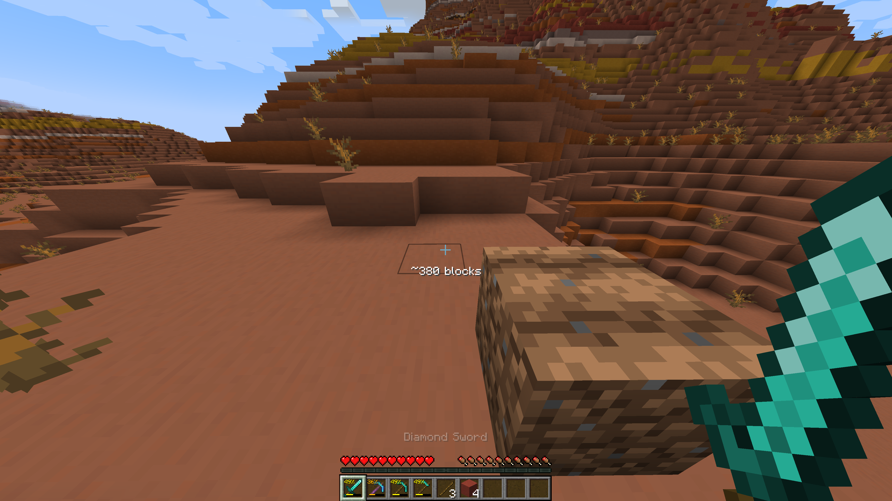

# Durability Percents

A lightweight, client-side NeoForge mod for Minecraft 1.21.1 that makes tool durability readable at a glance.

## Features

- **Durability percentage** on every damaged tool, in the hotbar and inventory, color-matched to the vanilla durability bar.
- **Blocks-left estimate** under the crosshair, showing roughly how many more blocks your held tool can mine.



## How the estimate works

`blocks left ≈ remaining durability × (Unbreaking level + 1) ÷ durability cost per block`

- Cost per block is read from the tool's own data (1 for most tools, 2 for swords), so modded tools that follow vanilla rules are supported automatically.
- Unbreaking gives each use a chance to cost nothing, so the estimate is an average; it moves in steps of (level + 1).
- Hidden for instant-break blocks (no durability cost) and in creative mode.

## Installation

1. Install NeoForge for Minecraft 1.21.1.
2. Drop the jar into your `mods` folder.

Client-side only: servers don't need it, and you can join servers that don't have it.

## Building from source

Requires JDK 21.

```
gradlew build
```

The jar is output to `build/libs/`.

## License

MIT